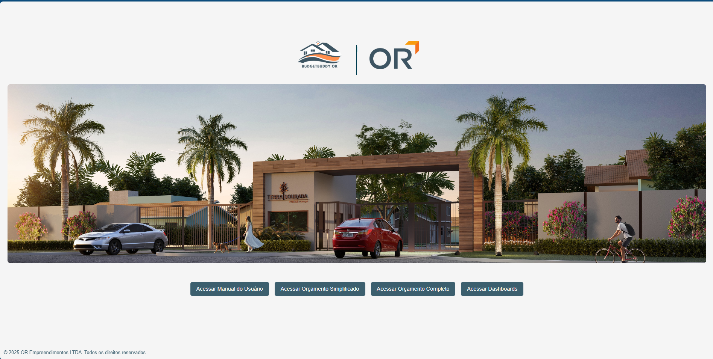
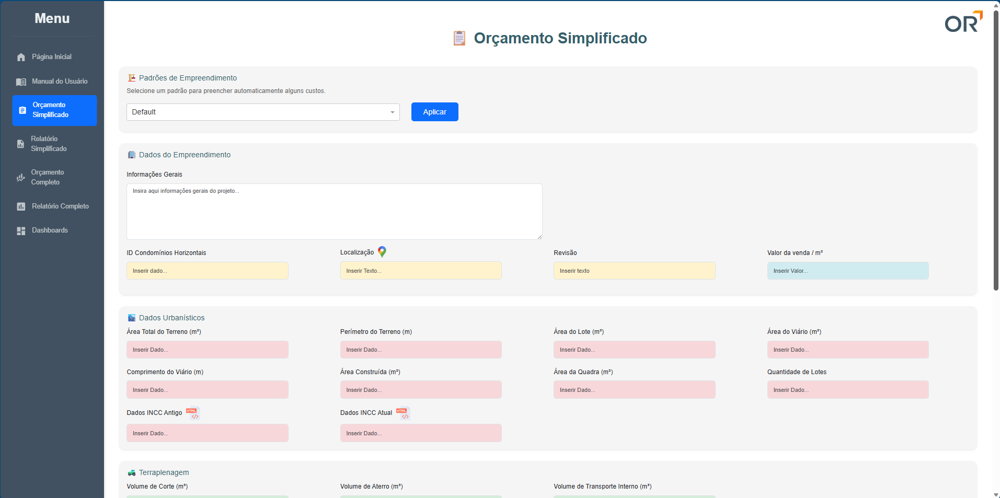
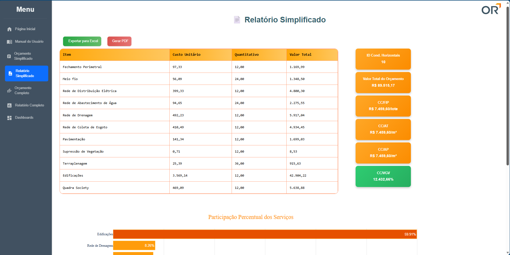
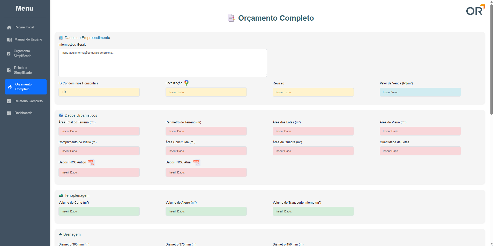
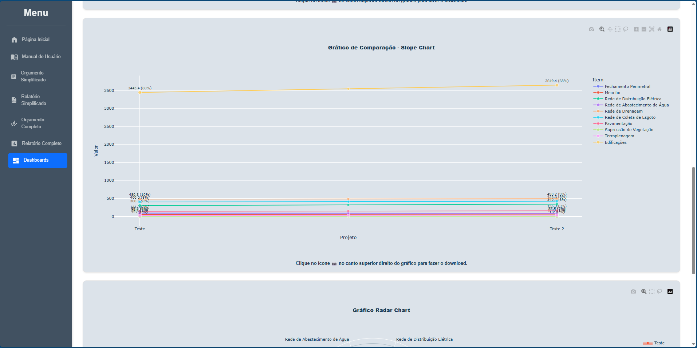
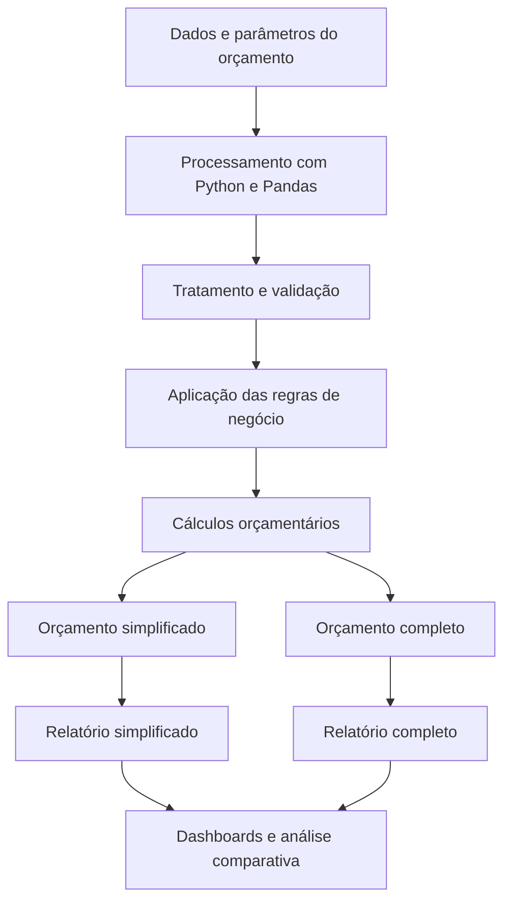


# Budget Buddy — Orçamentos Paramétricos

Aplicação web desenvolvida em Python e Dash para automatizar a elaboração, o processamento e a análise de orçamentos paramétricos de empreendimentos.

A solução centraliza a elaboração de orçamentos, a geração de relatórios e a análise comparativa de informações, disponibilizando dashboards interativos e diferentes níveis de detalhamento para apoiar a tomada de decisão.

## Contexto e objetivo

O projeto foi desenvolvido para otimizar o processo de elaboração de orçamentos paramétricos, reduzindo o tempo dedicado às atividades manuais de processamento, consolidação e análise das informações.

A aplicação organiza as etapas de elaboração e análise de orçamentos em uma interface web integrada, permitindo a utilização de versões simplificadas e detalhadas, além da visualização de indicadores e relatórios gerenciais.

## Resultados

| Indicador | Antes | Depois |
|---|---:|---:|
| Tempo de elaboração do orçamento paramétrico | 4 a 5 horas | 15 minutos |

**Redução de aproximadamente 94% a 95% no tempo de execução do processo.**

Além da redução do tempo operacional, a solução contribuiu para:

- Automatização da elaboração de orçamentos paramétricos.
- Padronização dos processos de cálculo e análise.
- Centralização das informações orçamentárias.
- Simplificação da geração de relatórios.
- Maior agilidade na análise comparativa de orçamentos.
- Apoio à tomada de decisão.

## Funcionalidades

- Elaboração de orçamentos paramétricos.
- Processamento e tratamento de dados com Python e Pandas.
- Aplicação de regras de negócio e cálculos orçamentários.
- Elaboração de orçamentos simplificados e completos.
- Geração e visualização de relatórios gerenciais.
- Dashboards interativos com gráficos e indicadores.
- Análise comparativa de informações orçamentárias.
- Filtros interativos para exploração dos dados.
- Navegação entre módulos por menu lateral.
- Manual do usuário integrado à aplicação.
- Interface web com estilos personalizados.
- Suporte à execução em containers Docker.

## Interface da aplicação

### Página inicial



### Manual do usuário


### Orçamento simplificado



### Relatório simplificado



### Orçamento completo



### Relatório completo


### Análise comparativa




### Visualização complementar do orçamento


## Módulos da aplicação

| Módulo | Descrição |
|---|---|
| Home | Página inicial com apresentação e navegação entre os módulos. |
| Dashboards | Visualização consolidada de informações, gráficos e indicadores. |
| Orçamento Simplificado | Elaboração e visualização de orçamentos com menor nível de detalhamento. |
| Orçamento Completo | Elaboração de orçamentos detalhados, com campos e validações adicionais. |
| Relatório Simplificado | Visualização resumida das informações orçamentárias. |
| Relatório Completo | Análise detalhada dos orçamentos com filtros adicionais. |
| Manual | Documentação e orientações para utilização da aplicação. |

## Fluxo de processamento

A aplicação recebe as informações necessárias à elaboração dos orçamentos, realiza o processamento dos dados e aplica as regras de negócio para disponibilizar os resultados em relatórios e dashboards.



## Tecnologias utilizadas

| Tecnologia | Finalidade |
|---|---|
| Python | Desenvolvimento, processamento de dados e cálculos |
| Pandas | Manipulação, transformação e análise de dados |
| Dash | Desenvolvimento da aplicação web interativa |
| HTML | Estruturação da interface |
| CSS | Estilização personalizada |
| Docker | Containerização da aplicação |
| Docker Compose | Configuração e execução do ambiente |
| Git | Controle de versão |
| GitHub | Versionamento e documentação do projeto |

## Estrutura do projeto

```text
.
├── app.py
├── index.html
├── requirements.txt
├── Dockerfile
├── docker-compose.yml
├── estrutura.txt
├── assets/
│   ├── styles.css
│   └── print/
│       ├── print1.png
│       ├── print2.png
│       ├── print3.png
│       ├── print4.png
│       ├── print5.png
│       ├── print6.png
│       ├── print7.png
│       ├── print8.png
│       ├── print9.png
│       └── print10.png
├── layouts/
│   ├── dashboards_page.py
│   ├── home_page.py
│   ├── manual_page.py
│   ├── orcamento_completo_page.py
│   ├── orcamento_simples_page.py
│   ├── relatorio_completo_page.py
│   └── relatorio_simples_page.py
└── callbacks/
    ├── callbacks_dashboards.py
    ├── callbacks_completo.py
    └── callbacks_simples.py
```

## Como utilizar

1. Acesse a interface da aplicação.
2. Selecione o módulo de orçamento simplificado ou completo.
3. Informe os parâmetros necessários à elaboração do orçamento.
4. Consulte os resultados processados.
5. Acesse os relatórios correspondentes.
6. Utilize os dashboards para exploração e análise comparativa das informações.

## Como executar

### Requisitos

- Python 3.9 ou superior.
- Dependências disponíveis no arquivo `requirements.txt`.
- Docker e Docker Compose (opcional).

### 1. Clonar o repositório

```bash
git clone https://github.com/paesdj1987/budget-buddy.git
cd budget-buddy
```

### 2. Criar um ambiente virtual

```bash
python -m venv .venv
```

Ativação no Windows:

```bash
.venv\Scripts\activate
```

Ativação no Linux/macOS:

```bash
source .venv/bin/activate
```

### 3. Instalar as dependências

```bash
pip install -r requirements.txt
```

### 4. Executar a aplicação

```bash
python app.py
```

Acesse a aplicação pelo navegador:

http://127.0.0.1:8050

## Executar com Docker

Como alternativa à instalação local, o projeto disponibiliza arquivos de configuração para execução em containers.

### Docker

Construir a imagem:

```bash
docker build -t budget-buddy .
```

Executar o container:

```bash
docker run -p 8050:8050 budget-buddy
```

### Docker Compose

Construir e iniciar o ambiente:

```bash
docker compose up --build
```

Encerrar o ambiente:

```bash
docker compose down
```

## Competências aplicadas

- Análise de dados.
- Análise de custos e informações orçamentárias.
- Automação de processos.
- Manipulação e transformação de dados.
- Implementação de regras de negócio.
- Desenvolvimento de cálculos automatizados.
- Business Intelligence.
- Desenvolvimento de dashboards interativos.
- Automação de relatórios gerenciais.
- Desenvolvimento de aplicações web orientadas a dados.
- Arquitetura modular de aplicações.
- Containerização com Docker.
- Versionamento de código.

## Observações

A aplicação foi desenvolvida considerando regras de negócio específicas do processo de elaboração de orçamentos paramétricos.

A utilização em outros contextos pode exigir adaptações nos parâmetros, cálculos e regras de processamento.

## Autor

**João Paes**

- [GitHub](https://github.com/paesdj1987)
- [LinkedIn](https://www.linkedin.com/in/joao-paes87)
- [Portfólio](https://joao-paes.vercel.app/)

