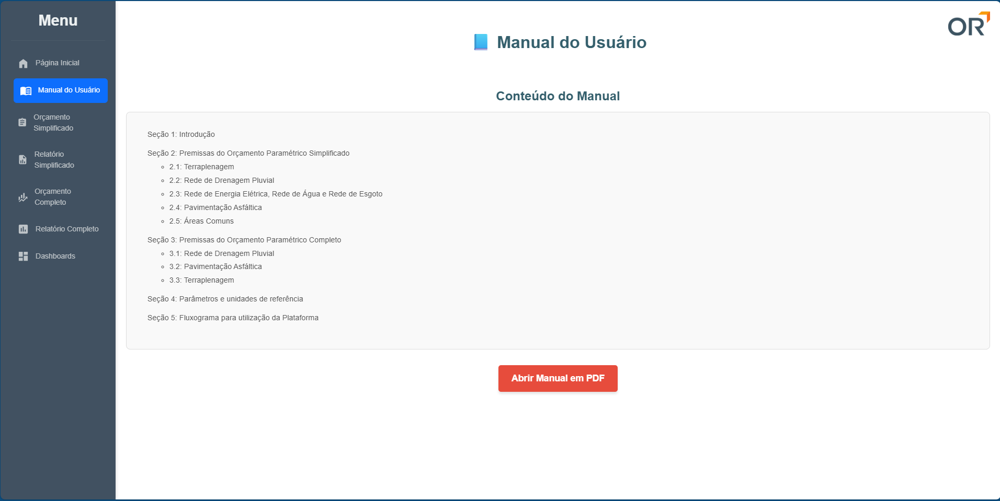
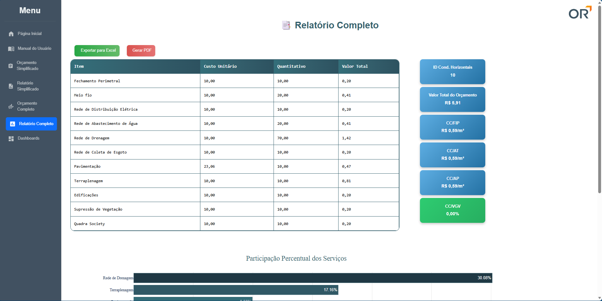
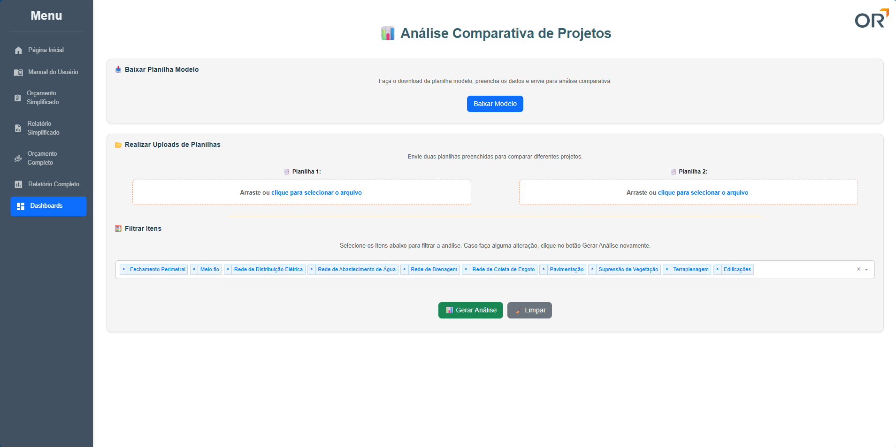
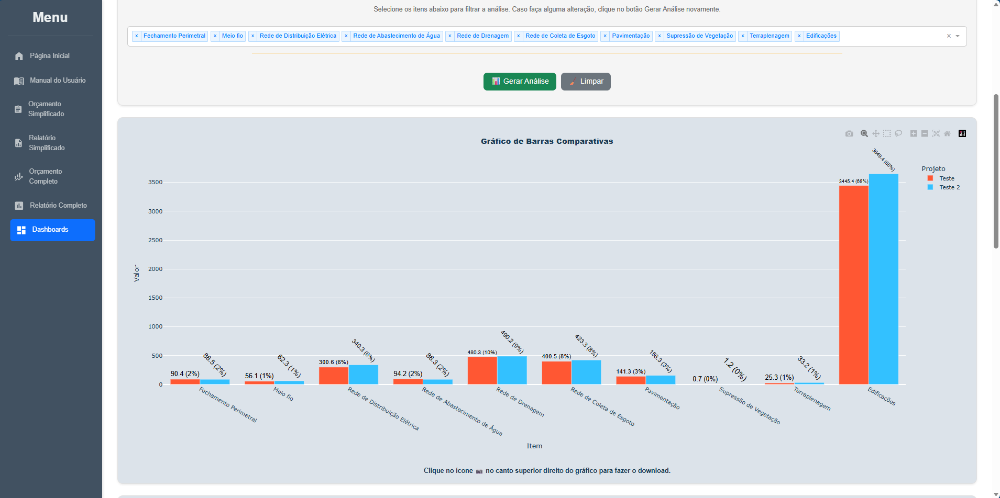
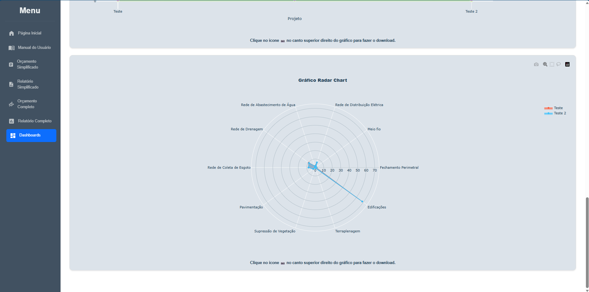

# 📊 dash_or – Aplicação Dash para Orçamentos e Relatórios

## 📝 Descrição

**dash_or** é uma aplicação web construída com **Python** e **Dash** para auxiliar na visualização e análise de orçamentos paramétricos. O app organiza páginas temáticas (dashboards, orçamentos e relatórios nas versões simples e completas), com navegação via sidebar e callbacks reativos.

---

## 📷 Capturas de Tela












---

## ⚙️ Tecnologias Utilizadas

- **Python**
- **Dash** 
- **Pandas** 
- **Git/GitHub** 

---

## 🛠️ Requisitos

- Python 3.9+ instalado
- Ambiente virtual recomendado
- Dependências listadas em `requirements.txt`

Opcional:
- Docker e Docker Compose instalados

---

## 🚀 Instalação (Local)

1) Clone o repositório:

```bash
git clone https://github.com/paesdj1987/dash_or.git
cd dash_or
```

2) Crie e ative o ambiente virtual:

- Windows:
  ```bash
  python -m venv venv
  venv\Scripts\activate
  ```
- Linux/Mac:
  ```bash
  python -m venv venv
  source venv/bin/activate
  ```

3) Instale as dependências:

```bash
pip install -r requirements.txt
```

4) Execute a aplicação:

```bash
python app.py
```

A aplicação tende a iniciar localmente em `http://127.0.0.1:8050`.

---

## 🐳 Executar com Docker (Opcional)

Build e run com Docker:

```bash
docker build -t dash_or .
docker run -p 8050:8050 dash_or
```

Ou usando Docker Compose:

```bash
docker-compose up --build
```

Parar e remover:

```bash
docker-compose down
```

---

## 🧭 Estrutura do Projeto

```text
dash_or/
├── app.py                     # Ponto de entrada da aplicação Dash
├── index.html                 # Template HTML
├── requirements.txt           # Dependências do projeto
├── Dockerfile                 # Build da imagem Docker
├── docker-compose.yml         # Orquestração local com Compose
├── estrutura.txt              # Notas/estrutura auxiliares
├── assets/
│   └── styles.css             # Estilos customizados da aplicação
├── layouts/
│   ├── dashboards_page.py     # Página: Dashboards
│   ├── home_page.py           # Página: Home
│   ├── manual_page.py         # Página: Manual/ajuda
│   ├── orcamento_completo_page.py   # Página: Orçamento Completo
│   ├── orcamento_simples_page.py    # Página: Orçamento Simples
│   ├── relatorio_completo_page.py   # Página: Relatório Completo
│   └── relatorio_simples_page.py    # Página: Relatório Simples
└── callbacks/
    ├── callbacks_dashboards.py # Callbacks da página de Dashboards
    ├── callbacks_completo.py   # Callbacks de telas completas
    └── callbacks_simples.py    # Callbacks de telas simples
```

---

## 🗺️ Páginas e Funcionalidades

- Home: visão inicial, navegação e contexto do app.
- Dashboards: visões consolidadas, gráficos e indicadores.
- Orçamento Simples: criação/visualização de orçamentos simplificados.
- Orçamento Completo: versão detalhada, com mais campos e validações.
- Relatório Simples: geração/visualização de relatórios resumidos.
- Relatório Completo: relatórios detalhados com mais filtros.
- Manual: instruções de uso, atalhos e documentação.
- Sidebar: navegação entre páginas e seções do app.

---

## 🔧 Configuração

- Variáveis de ambiente (se aplicável): defina-as antes de iniciar a aplicação (ex.: `PORT`, `HOST`).
- Estilos: edite `assets/styles.css` para ajustar aparência.

---

## 👤 Autor

Desenvolvido por João Paes  
🔗 github.com/paesdj1987

